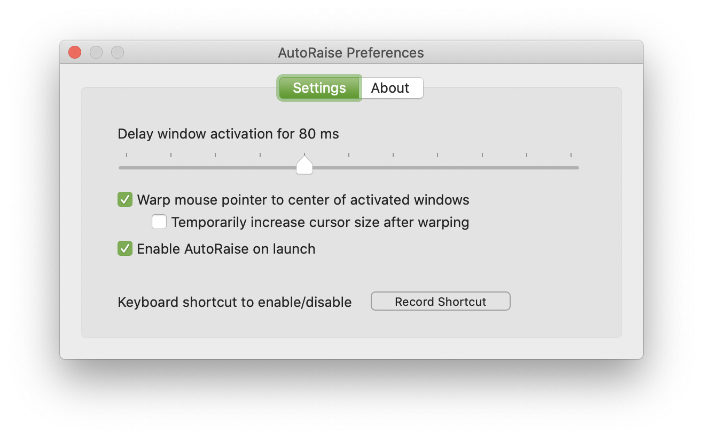

# AutoRaise & Launcher                      

This project consists of two components: AutoRaise and Launcher. 

The **AutoRaise** binary is written and maintained by Stefan Post at https://github.com/sbmpost/AutoRaise. From the readme:

> When you hover a window it will be raised to the front (with a delay of your choosing) and gets the focus. There is also an option to warp the mouse to the center of the activated window when using the cmd-tab key combination.
> 
> See also: https://stackoverflow.com/questions/98310/focus-follows-mouse-plus-auto-raise-on-mac-os-x

While AutoRaise is concerned with GUI window and mouse behaviour, as a command line application it lacks a GUI itself.

Here's where the **Launcher** app bundle comes into play: a menubar application that allows to control and configure the AutoRaise binary. A mouse click on it's menubar icon will start/stop AutoRaise, preferences can be configured from it's context menu and will be saved between sessions.

The two startup settings intentionally control different things:

- **Enable AutoRaise when app opens** starts the AutoRaise engine whenever the Launcher app opens.
- **Open AutoRaise at login** registers the Launcher as a native macOS login item. This setting requires macOS 13 or later and may require approval in System Settings > General > Login Items.
 
 

Please note that this project does not alter the upstream AutoRaise code, it merely wraps an app bundle around it for convenience.

## Installing

There is no installer or pre-built binary being distributed via Github but AutoRaise & Launcher binaries can be installed via [MacPorts](https://www.macports.org):

`sudo port install AutoRaise`

This installs the menubar app bundle (which includes a copy of the upstream AutoRaise cli binary) into your Applications folder and symlinks the cli into the Path, usually into `/opt/local/bin`

## Building from source

Simply clone, open and build this project in XCode. 

For a stable development build, run `./script/build_and_run.sh`. It builds and launches `/Applications/AutoRaise Dev.app` with bundle identifier `com.sbmpost.AutoRaise.dev` and a valid Apple Development identity from the login keychain. The script fails if stable signing is unavailable instead of falling back to ad-hoc signing. Keeping the app name, bundle identifier, signing team, and launch path stable allows macOS Accessibility permission to survive rebuilds. Release builds keep the production `AutoRaise` name and `com.sbmpost.AutoRaise` bundle identifier.

Like upstream XCode will first build the AutoRaise binary by running

`g++ -O2 -Wall -fobjc-arc -D"NS_FORMAT_ARGUMENT(A)=" -DSKYLIGHT_AVAILABLE=1 -DEXPERIMENTAL_FOCUS_FIRST -DALTERNATIVE_TASK_SWITCHER -DOLD_ACTIVATION_METHOD -o AutoRaise AutoRaise.mm -framework AppKit -F /System/Library/PrivateFrameworks -framework SkyLight`

and include it when finally building the Launcher app bundle (AutoRaise.app).

To install copy AutoRaise.app into the `/Applications` folder and/or the AutoRaise binary to e.g. `/usr/local/bin`

## Running & Configuring

Open AutoRaise.app and click on the menubar icon to enable/disable AutoRaise with default settings. Preferences are saved between sessions in the default `~/Library/Preferences` folder.
On first launch you should be prompted to grant access for AutoRaise in _System Preferences > Security & Privacy > Privacy > Accessibility_.

More options to run and configure AutoRaise are explained in the upstream project's Readme.

## Contributing

This repository is the source of truth for the macOS Launcher, Preferences UI, app bundle, and login-item integration. Submit GUI issues and pull requests here: https://github.com/sbmpost/AutoRaise-UI.

The AutoRaise engine and command-line options are maintained separately. Submit engine issues and pull requests to https://github.com/sbmpost/AutoRaise.
